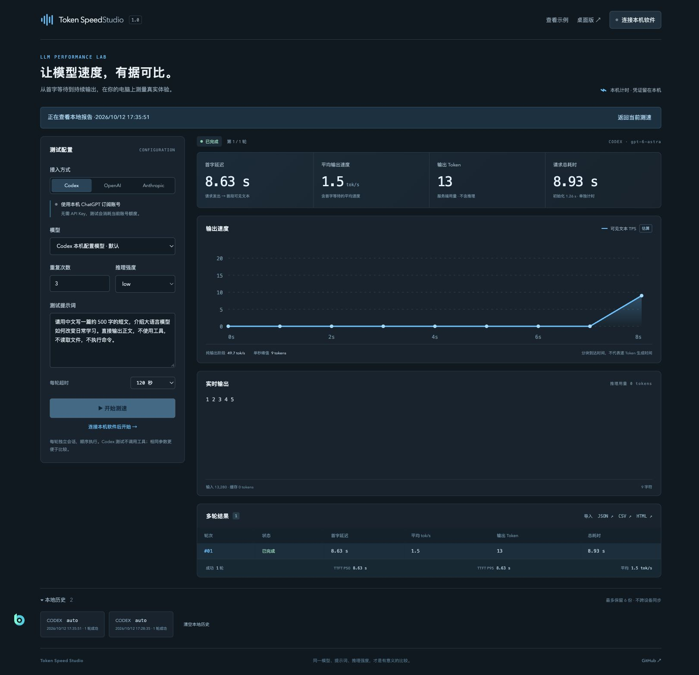

# Token Speed Tester / Studio

> 测量 LLM 与 Codex 的首字延迟、Token 吞吐和流式输出速度，支持 CLI、网页及 macOS / Windows / Linux 桌面端。

[English](README.en.md) · [打开网页](https://token-speed-studio.cansiny0320.chatgpt.site) · [下载桌面版](https://github.com/Cansiny0320/token-speed-tester/releases/tag/desktop-v1.1.0) · [Studio 文档](docs/studio.md)

[](https://www.npmjs.com/package/token-speed-tester)
[](https://opensource.org/licenses/MIT)
[](https://github.com/Cansiny0320/token-speed-tester/actions/workflows/ci.yml)

<p align="center">
  
</p>

**Token Speed Studio** 提供桌面与网页工作台，**token-speed-tester** 提供 CLI。支持本机已登录的 **Codex / ChatGPT 订阅账号**、**OpenAI Chat Completions** 和 **Anthropic Messages**。截图为一次真实短样本的历史报告，仅用于展示界面，不代表模型性能基准。

## 特性

- **三种接入方式**：本机 Codex、OpenAI 兼容 API、Anthropic 兼容 API。
- **网页与桌面**：实时文本和 TPS 曲线；桌面版可独立运行，网页通过配对码连接本机软件。
- **测速指标**：TTFT、平均吞吐、单秒峰值、多轮统计；Studio 单独记录初始化耗时、输出和推理用量。
- **Codex 控制**：模型、推理强度、重复次数、超时与取消。每轮独立临时会话，禁用工具、MCP、插件和 hooks。
- **Codex 历史分析**：读取本机会话与归档，按日期、模型、推理强度和服务档位统计，查看轮次明细并导出 JSON / CSV；不调用模型。
- **本地报告**：JSON / CSV / HTML 导出；Studio 保留最近 6 份本地报告，并支持导入自己的 JSON 报告。失败或取消轮次不进入 Studio 汇总。
- **CLI**：终端图表、自定义端点、中英文输出和报告；兼容原有 API 用法。

Codex 登录凭证留在本机，测试会消耗当前账号额度。可用模型与推理强度以本机 Codex 返回的信息为准。

## 桌面版与网页

公开网页是静态前端，测速由访问者电脑上的桌面软件执行，不提供云端账号或代跑服务。

| 系统 | 安装包 |
| --- | --- |
| macOS Apple Silicon | [dmg](https://github.com/Cansiny0320/token-speed-tester/releases/download/desktop-v1.1.0/Token-Speed-Studio-1.1.0-mac-arm64.dmg) |
| macOS Intel | [dmg](https://github.com/Cansiny0320/token-speed-tester/releases/download/desktop-v1.1.0/Token-Speed-Studio-1.1.0-mac-x64.dmg) |
| Windows x64 | [exe](https://github.com/Cansiny0320/token-speed-tester/releases/download/desktop-v1.1.0/Token-Speed-Studio-1.1.0-win-x64.exe) |
| Linux x64 · AppImage | [AppImage](https://github.com/Cansiny0320/token-speed-tester/releases/download/desktop-v1.1.0/Token-Speed-Studio-1.1.0-linux-x86_64.AppImage) |
| Debian / Ubuntu x64 | [deb](https://github.com/Cansiny0320/token-speed-tester/releases/download/desktop-v1.1.0/Token-Speed-Studio-1.1.0-linux-amd64.deb) |

[完整发布与 ZIP 包](https://github.com/Cansiny0320/token-speed-tester/releases/tag/desktop-v1.1.0) · [SHA256SUMS.txt](https://github.com/Cansiny0320/token-speed-tester/releases/download/desktop-v1.1.0/SHA256SUMS.txt)。macOS 安装包未签名或公证；macOS Apple Silicon 的历史扫描已验证，Windows 与 Linux 未进行本次版本的对应系统实机验证，详见发布说明。

1. 安装并打开桌面版。测试 Codex 时，先安装 Codex CLI 并执行 `codex login`；已登录的 ChatGPT 账号可直接复用。找不到可执行文件时，在软件中手动选择路径。
2. 在桌面版选择接入方式、模型、提示词和次数，直接开始测速。API 模式填写对应的 API Key 和端点。
3. 如需网页操作，打开[网页](https://token-speed-studio.cansiny0320.chatgpt.site)，填写桌面端显示的端口与配对码，在桌面弹窗中确认来源，并允许浏览器访问本地网络。
4. 配对码 5 分钟有效，连接最长 8 小时，退出桌面版后失效。

Chrome 已通过配对与真实测速验证。Codex 内置浏览器在本次验收中连接超时，遇到连接问题时可直接使用桌面版。

**版本说明（2026-10-12）**：桌面版 `1.1.0` 已发布，新增 Codex 历史会话分析并修正测速计量；npm 当前发布版为 `1.11.1`，Studio / Codex 功能尚未发布到 npm。下方 npm 命令用于 API CLI；Codex 请使用桌面版或源码入口。升级桌面版后，请完全退出旧进程再启动。

### Codex 历史会话分析

在桌面版或已配对网页中切换到「历史会话分析」，选择近 7 天或自定义日期范围。可按模型、推理强度和服务档位查看统计、轮次明细，并取消分析或导出 JSON / CSV。

分析只读取本机保留的 Codex 日志，不调用模型。正文仅在本机用于分词，不进入网页或导出；历史消息速度是估算，不提供缺少流式数据的 TPS 曲线或峰值。结果仅代表本机保留的日志，详细口径见 [Studio 文档](docs/studio.md#历史会话分析)。

## 安装

### 全局安装（推荐）

```bash
npm install -g token-speed-tester
```

### 使用 npx（无需安装）

```bash
npx token-speed-tester --api-key sk-xxx
```

### 本地安装

```bash
npm install token-speed-tester
```

## 使用方法

### 基本用法

```bash
# 测试 OpenAI API（默认）
token-speed-tester --api-key sk-xxx
# 输出英文结果
token-speed-tester --api-key sk-xxx --lang en

# 测试 Anthropic API
token-speed-tester --api-key sk-ant-xxx --provider anthropic
```

### 高级选项

```bash
# 自定义模型和多次测试
token-speed-tester \
  --api-key sk-ant-xxx \
  --provider anthropic \
  --model claude-opus-4-5-20251101 \
  --runs 5

# 测试自定义端点和提示词
token-speed-tester \
  --api-key sk-xxx \
  --provider openai \
  --url https://api.example.com/v1 \
  --model custom-model \
  --prompt "解释量子计算" \
  --max-tokens 2048 \
  --runs 10

# 生成 HTML 报告（包含 SVG 图表）
token-speed-tester \
  --api-key sk-xxx \
  --output-format html \
  --output my-report.html

# 生成 JSON 报告
token-speed-tester \
  --api-key sk-xxx \
  --output-format json \
  --output report.json

# 生成 CSV 报告
token-speed-tester \
  --api-key sk-xxx \
  --output-format csv \
  --output report.csv

# 组合使用：生成英文 HTML 报告
token-speed-tester \
  --api-key sk-xxx \
  --runs 5 \
  --output-format html \
  -o performance-report.html \
  --lang en
```

### 从源码运行 Codex

以下命令使用 Studio 功能分支。固定复现桌面版 1.1.0 时，可将分支名换成 `desktop-v1.1.0`。

```sh
git clone --branch feat/token-speed-studio https://github.com/Cansiny0320/token-speed-tester.git
cd token-speed-tester
pnpm install
pnpm build

# 本机已登录的 Codex，无需 API Key
node dist/index.mjs --provider codex --runs 1 --effort low --output-format terminal

# 指定路径并导出报告
node dist/index.mjs --provider codex --codex-path /path/to/codex \
  --timeout 120000 --output-format json --output codex-report.json
```

省略 `--model` 使用本机 Codex 配置模型。`--max-tokens` 仅用于 API；Codex 通过提示词约束输出长度，以 `--timeout` 限制每轮耗时。

## 当前源码的命令行选项

| 选项              | 简写 | 说明                                     | 默认值                 |
| ----------------- | ---- | ---------------------------------------- | ---------------------- |
| `--api-key`       | `-k` | API 模式必填；Codex 不需要                          | -                      |
| `--provider`      | `-p` | 接入方式：`anthropic` / `openai` / `codex`        | `openai`               |
| `--model`         | `-m` | 模型名称                                 | 根据提供商自动选择     |
| `--url`           | `-u` | 自定义 API 端点                          | 官方端点               |
| `--runs`          | `-r` | 测试次数                                 | `3`                    |
| `--prompt`        |      | 测试提示词                               | "写一篇关于 AI 的短文" |
| `--max-tokens`    |      | API 最大输出 Token 数                        | `1024`                 |
| `--lang`          |      | 输出语言: `zh` 或 `en`                   | `zh`                   |
| `--output-format` | `-f` | 输出格式：`terminal`/`json`/`csv`/`html` | `html`                 |
| `--output`        | `-o` | 输出文件路径（默认 `report.{ext}`）      | `report.{ext}`         |
| `--codex-path` | | Codex 可执行文件路径 | 自动检测 |
| `--effort` | | Codex 推理强度，需由所选模型支持 | `low` |
| `--timeout` | | Codex 每轮超时，单位 ms，范围 `5000–600000` | `120000` |

### 默认模型

- **Anthropic**: `claude-opus-4-5-20251101`
- **OpenAI**: `gpt-5.2`
- **Codex**: `auto`（本机配置模型）

以上为项目配置值，可用 `--model` 覆盖，不代表最新模型或当前账号一定有权限。

## 报告

### HTML 报告

使用 `--output-format html` 选项可以生成精美的 HTML 报告，报告包含：

- **速度趋势图**：多条运行的速度曲线对比（SVG 动画）
- **TPS 分布图**：每秒 Token 数的直方图
- **统计汇总卡片**：TTFT、平均速度、峰值速度等核心指标
- **详细数据表格**：每次运行的完整数据
- **响应式设计**：支持桌面和移动设备
- **中英文支持**：根据 `--lang` 自动切换

报告生成后会自动在浏览器中打开。

## CLI 指标说明

| 指标            | 说明                                                |
| --------------- | --------------------------------------------------- |
| **TTFT**        | 从请求发出到第一段非空可见文本到达            |
| **总耗时**      | 从请求到流式响应完成的完整时长                      |
| **总 Token 数** | 接收到的输出 Token 数量                             |
| **平均速度**    | 每秒平均 Token 数（totalTokens / totalTime × 1000） |
| **峰值速度**    | 至少 10 个 Token、优先覆盖 50ms 的滑动窗口内最快速度                |
| **峰值 TPS**    | 单秒内最高 Token 数                                 |
| **TPS 曲线**    | 整个流式响应中每秒接收的 Token 数                   |

注：总 Token 数优先采用服务端 usage（OpenAI 会扣除单独报告的 reasoning tokens），缺失时对完整输出文本统一分词估算。OpenAI 官方地址会请求流式 usage；自定义兼容地址不强制发送 `stream_options`，但会使用响应中已有的 usage。

TPS 曲线及峰值基于完整可见文本的本地分词，并将每个 Token 映射到其最后一个字节到达的分片时间；它们是客户端观测估算，与服务端总数可能不同。未知模型使用 `cl100k_base` 估算。峰值窗口优先扩展至 50ms，短流使用实际可观察时长；所有 Token 同时到达时无法推断生成速率，峰值记为 0。TTFT 在首个非空文本到达时记录，总耗时不包含 tokenizer 初始化、结束后的分词和资源释放。

OpenAI 的 GPT-5 及更新系列、o 系列使用 `max_completion_tokens`，该上限包含推理 Token；旧模型和其他兼容模型保留 `max_tokens`。

Studio 单独记录初始化耗时与原始服务端用量。比较时请保持模型、提示词、推理强度、输出长度和网络条件尽量一致。Studio JSON 与 CLI JSON 使用不同结构，Studio 导入功能用于自己导出的报告。

## 开发

### 网页与桌面

三个目录分别安装依赖，包管理器版本见各自 `package.json`。CLI 需要 Node.js 18 或更高版本。

```sh
pnpm install
pnpm --dir apps/site install
pnpm --dir apps/desktop install

# 两个终端分别启动
pnpm --dir apps/site dev
pnpm --dir apps/desktop dev

pnpm lint
pnpm typecheck
pnpm test
pnpm build
pnpm --dir apps/desktop exec tsc --noEmit
pnpm --dir apps/desktop build
```

网页开发地址为 `http://127.0.0.1:5173`。安装包构建与部署流程见 [Studio 文档](docs/studio.md)。

### 运行测试

```bash
# 运行测试
pnpm test

# 使用 UI 运行测试
pnpm test:ui

# 生成覆盖率报告
pnpm test:coverage
```

### 构建

```bash
pnpm build
```

### CLI / npm 发布

本项目通过 GitHub Actions 自动发布到 npm。发布流程：

```bash
pnpm release          # 交互式选择版本类型
# 或
pnpm release patch    # 补丁版本 (1.0.0 -> 1.0.1)
pnpm release minor    # 次要版本 (1.0.0 -> 1.1.0)
pnpm release major    # 主要版本 (1.0.0 -> 2.0.0)
```

bumpp 会自动完成：更新版本 → 提交 → 打 tag → 推送

推送 `v*` tag 后，GitHub Actions 会自动：

- 构建项目
- 发布到 npm
- 创建 GitHub Release

### 桌面与网页发布

[Desktop Build workflow](.github/workflows/desktop.yml) 通过手动触发构建三平台安装包并上传 Actions artifacts；GitHub Release 单独发布，使用 `desktop-v*` tag。Sites 网页独立保存版本和部署，不随 npm 或桌面版本自动更新。

## 验证

`desktop-v1.0.0` 发布源码通过了 215 项测试、lint、类型检查和构建；CLI、Mac Apple Silicon 打包应用及 Chrome 网页均完成真实 Codex 测速。运行 `pnpm test:coverage` 获取当前覆盖率。

## 赞助

如果这个项目对你有帮助，欢迎通过微信或支付宝支持后续开发。感谢你的支持！


## 开源协议

MIT © [Cansiny0320](https://github.com/Cansiny0320)

## 贡献

欢迎贡献！请随时提交 Pull Request。

## 相关链接

- [公开网页](https://token-speed-studio.cansiny0320.chatgpt.site)
- [桌面安装包](https://github.com/Cansiny0320/token-speed-tester/releases/tag/desktop-v1.1.0)
- [Studio 文档](docs/studio.md)
- [npm 包](https://www.npmjs.com/package/token-speed-tester)
- [GitHub 仓库](https://github.com/Cansiny0320/token-speed-tester)
- [问题反馈](https://github.com/Cansiny0320/token-speed-tester/issues)
- [更新日志](https://github.com/Cansiny0320/token-speed-tester/blob/master/CHANGELOG.md)
